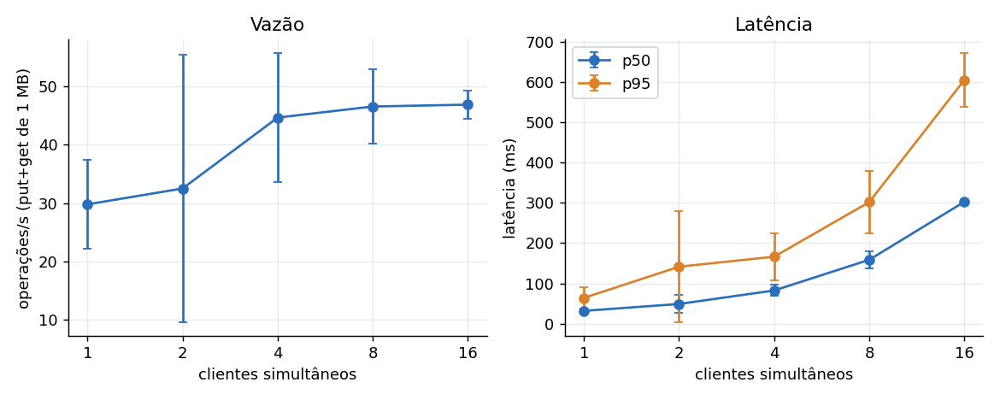
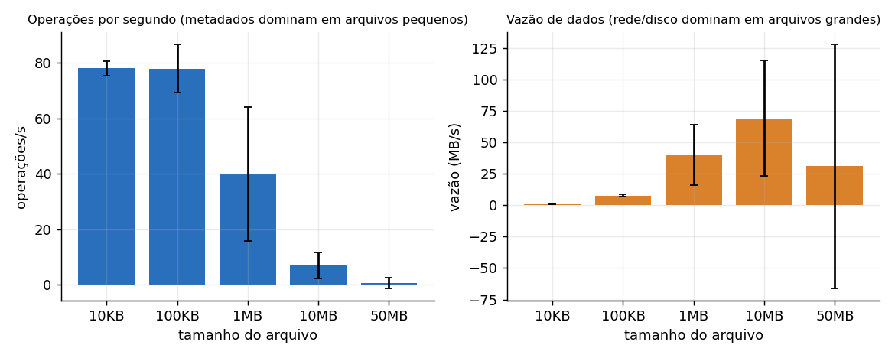
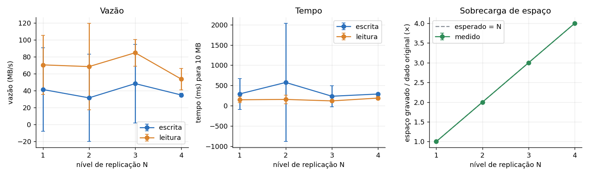
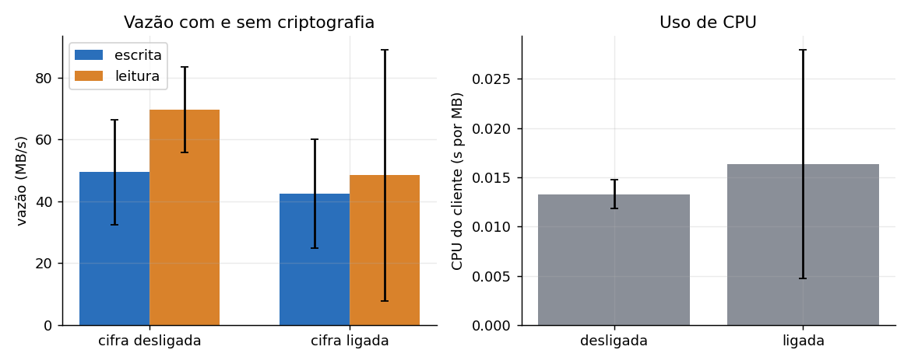
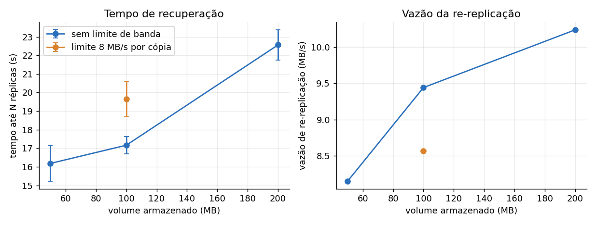
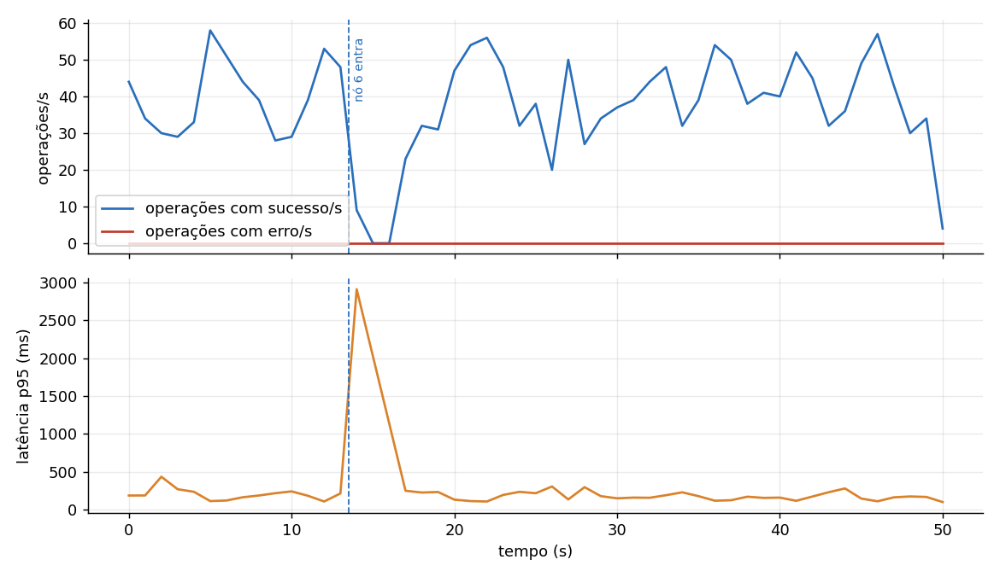
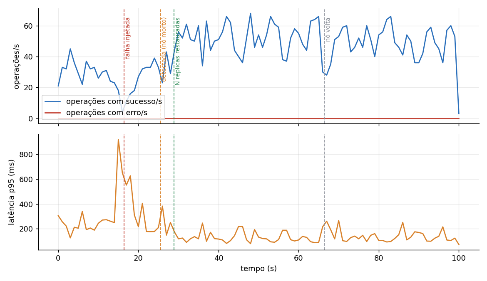

# Relatório de testes — DFS

## 1. Ambiente e versão testada

- Versão testada (tag Git): `4c19da0`
- Software: Docker version 28.3.2, build 578ccf6; Python 3.12 (imagem `python:3.12-slim`); FastAPI/uvicorn; SQLite; `cryptography` (AES-GCM).
- Topologia: **1 controlador (+ metadados) e 5 nós de armazenamento** (6º nó para os testes de entrada de nós), cada nó com seu volume Docker; disco simulado de 500 MB por nó (`NODE_CAPACITY_MB`). Cliente e gerador de carga rodam em contêiner na mesma rede.
- **Todos os contêineres compartilham uma única máquina física** (Docker Desktop, 5,8 GiB de RAM para o Docker): CPU, memória e disco são disputados entre controlador, nós e clientes, e a rede é a rede virtual do Docker (latência desprezível, sem limite de banda real). Isso favorece a vazão absoluta e **não representa uma rede real**; só as comparações relativas entre configurações são confiáveis.
- *Preencher:* CPU (modelo/núcleos), RAM total, tipo de disco, `iperf3`/`ping` entre contêineres.
- Repetições: 4 por configuração (a 1ª, de aquecimento, é descartada ⇒ 3 válidas); média ± intervalo de confiança de 95% (t de Student).

## 2. Testes funcionais e de integridade

| ID | Objetivo | Esperado | Obtido | Status |
|---|---|---|---|---|
| F01 | Criar, listar e remover diretório (vazio vs não vazio) | rejeita remover não vazio | {'mkdir': True, 'ls_tem_sub': True, 'rmdir_nao_vazio_rejeitado': True, 'rmdir_vazio_ok': True} | passou |
| F02 | put + get de 10 MB devolve arquivo idêntico | sha256 igual |  Container dfs-controller-1  Running | sha256 igual ao original: True | passou |
| F03 | Réplicas nunca no mesmo disco/máquina | 0 violações | 3 blocos x 3 réplicas em nós e máquinas distintos; violações: [] | passou |
| F04 | Consulta de metadados (tamanho, data, hash, réplicas, estado) | campos presentes | ['  tamanho: 10485760 bytes', '  data: 2026-11-18 17:15:27', '  sha256: 8db4b46e4101e6f6b7e72ef2f6fbb60c90da96a5f1be87dcc02f7119cacb6ab8'] | passou |
| F05 | Renomear/mover e remover arquivo | ok | mv=True novo existe=True antigo sumiu=True rm=True | passou |
| F06 | Menos nós que N: aceita como sub-replicada e informa claramente | AVISO + estado sub-replicado | ['AVISO: bloco 0: só 6 de 7 nós: gravação ficará SUB-REPLICADA', 'AVISO: bloco 1: só 6 de 7 nós: gravação ficará SUB-REPLICADA', 'AVISO: bloco 2: só 6 de 7 nós: gravação ficará SUB-REPLICADA', 'OK /t1795022112/sub.bin: 10485760 by | passou |
| F07 | Duas escritas simultâneas no mesmo arquivo: leitura nunca vê arquivo parcial/misto | hash = v1 ou v2 | resultado é exatamente uma das duas versões (last-writer-wins), nunca mistura: True | passou |
| F08 | Criptografia ligada: nós só guardam dados cifrados; leitura devolve o original | sem texto claro nos nós | round-trip ok=True; texto claro encontrado nos discos dos nós=False | passou |
| F09 | Réplica corrompida: leitura detecta, usa outra réplica e o sistema substitui a cópia ruim | arquivo íntegro + N restaurado | detectada=True; arquivo íntegro=True; N=3 restaurado em 3.5s | passou |
| F10 | Scrubbing em segundo plano encontra réplica corrompida e a substitui | N restaurado | scrubbing detectou em 1.8s; réplica descartada e N=3 restaurado em 0.5s | passou |
| T01 | Queda de um nó: detecta (heartbeat), re-replica automaticamente e mantém leituras íntegras | N restaurado, hash correto | node3: morto em 11.4s, N=3 restaurado ~22.9s após a falha; leitura íntegra=True | passou |
| T02 | Nó que volta é reconhecido e seus blocos reconciliados | reconhecido, sem excesso de réplicas | node3 voltou em 1.6s; reconciliação: 28 blocos aproveitados, 0 descartados | passou |
| T03 | Falha simultânea de N-1 nós: zero perda de dados | leitura íntegra | com ['node1', 'node2'] fora (N-1=2 falhas) a leitura devolveu hash correto=True; N restaurado=True | passou |
| T04 | Reinício do controlador: metadados persistem e nós se re-registram sozinhos | estado preservado | metadados recarregados do SQLite; nós se re-registraram em 3.1s; arquivo íntegro | passou |
| T05 | Drain: esvazia um nó de forma planejada antes de retirá-lo | 3 réplicas fora do nó drenado | drain de node6 (49 blocos): 49 cópias feitas; arquivo com 3 réplicas fora dele em 16.0s | passou |
| T06 | Nó novo é descoberto automaticamente e passa a receber dados | registrado sem reiniciar o sistema | node6 descoberto em 1.6s (contado após o `up`) sem reiniciar nada; recebeu 12 réplica(s) nas 4 gravações seguintes | passou |

Resumo: **16/16** passaram. Evidências: `tests/results/functional.json`, logs dos contêineres (`docker compose logs`). Reexecutável: `python tests/functional.py`.

## 3. Tolerância a falhas

Procedimento de cada teste: (1) gravar arquivos e guardar os hashes de referência; (2) injetar a falha anotando a hora; (3) observar detecção, re-replicação e estado final; (4) baixar e comparar o SHA-256.

| Teste | Resultado medido |
|---|---|
| F09 corrupção na leitura | detectada_por=cliente (hash na leitura); reposicao_s=3.51; bloco=49c50d14545b-0; no_corrompido=node3 |
| F10 corrupção no scrubbing | detectada_em_s=1.84; reposicao_s=0.54; bloco=49c50d14545b-1; no_corrompido=node3 |
| T01 queda de 1 nó | no=node3; detectado_morto_em_s=11.4; n_restaurado_em_s=22.9; bytes_copiados=82861560; min_replicas_vivas=0 |

**Janela de vulnerabilidade e custo da recuperação:** ver E7/E9 abaixo. O tempo de detecção (~10–11 s) é dominado pelo timeout de heartbeat (`HEARTBEAT_DEAD_S=12`), um parâmetro configurável: reduzi-lo detecta mais rápido, ao custo de mais falsos positivos.

Critérios de sucesso: zero perda enquanto falhas simultâneas < N (T03 derrubou N−1=2 nós e todos os arquivos foram lidos com hash correto); todo arquivo lido tem hash correto (F02, F09, T01–T04); nível de replicação restaurado automaticamente (T01, F09, F10); o sistema não entrega dado corrompido (F09).

## 4. Escalabilidade e desempenho

### E2 — mais clientes simultâneos (put+get de 1 MB, 5 nós, N=3)

| Configuração | operações/s | MB/s agregados | latência p50 (ms) | latência p95 (ms) |
|---|---|---|---|---|
| 1 cliente(s) | 29.78 ± 7.65 | 29.78 ± 7.65 | 31.8 ± 5.3 | 64.0 ± 25.9 |
| 2 cliente(s) | 32.48 ± 22.84 | 32.48 ± 22.84 | 48.9 ± 22.3 | 141.4 ± 137.6 |
| 4 cliente(s) | 44.60 ± 11.03 | 44.60 ± 11.03 | 82.4 ± 14.1 | 166.3 ± 58.5 |
| 8 cliente(s) | 46.50 ± 6.32 | 46.50 ± 6.32 | 158.7 ± 20.9 | 301.9 ± 76.6 |
| 16 cliente(s) | 46.81 ± 2.36 | 46.81 ± 2.36 | 302.6 ± 2.4 | 605.3 ± 66.8 |

### E3 — tamanho dos arquivos (4 clientes)

| Configuração | operações/s | MB/s agregados | p50 (ms) | p95 (ms) |
|---|---|---|---|---|
| 10KB | 78.01 ± 2.55 | 0.76 ± 0.02 | 48.6 ± 4.8 | 103.9 ± 2.1 |
| 100KB | 77.96 ± 8.68 | 7.61 ± 0.85 | 48.5 ± 6.2 | 97.7 ± 13.8 |
| 1MB | 39.90 ± 24.22 | 39.90 ± 24.22 | 78.3 ± 6.8 | 300.8 ± 565.2 |
| 10MB | 6.91 ± 4.62 | 69.14 ± 46.16 | 439.9 ± 102.0 | 2241.2 ± 4923.9 |
| 50MB | 0.62 ± 1.94 | 30.87 ± 96.86 | 10791.0 ± 19221.4 | 16856.0 ± 31427.1 |

### E5 — custo da replicação (arquivo de 10 MB)

| Configuração | escrita (ms) | escrita (MB/s) | leitura (ms) | leitura (MB/s) | espaço gravado / original (×) |
|---|---|---|---|---|---|
| N=1 | 290.4 ± 382.2 | 41.21 ± 49.47 | 146.2 ± 75.0 | 70.29 ± 34.66 | 1.00 ± 0.00 |
| N=2 | 574.5 ± 1461.3 | 31.37 ± 51.60 | 155.2 ± 108.5 | 68.26 ± 51.06 | 2.00 ± 0.00 |
| N=3 | 233.9 ± 258.1 | 48.18 ± 46.34 | 118.6 ± 22.1 | 84.60 ± 15.75 | 3.00 ± 0.00 |
| N=4 | 288.1 ± 16.2 | 34.72 ± 1.96 | 188.2 ± 43.7 | 53.47 ± 12.71 | 4.00 ± 0.00 |

### E6 — custo da criptografia (arquivo de 20 MB; CPU = tempo de processo do cliente)

| Configuração | escrita (MB/s) | leitura (MB/s) | CPU do cliente (s/MB) |
|---|---|---|---|
| cifra desligada | 49.46 ± 16.98 | 69.64 ± 13.74 | 0.01 ± 0.00 |
| cifra ligada | 42.51 ± 17.66 | 48.40 ± 40.62 | 0.02 ± 0.01 |

### E7 — recuperação em escala (derruba o nó com mais blocos; N=3; 5 nós)

| Volume | Limite de banda | Nó | Blocos no nó | Detecção (s) | Recuperado em (s) | Copiado (MB) | Vazão re-replicação (MB/s) |
|---|---|---|---|---|---|---|---|
| 50 MB | banda_livre | node2 | 24 | 10.4 | 15.8 | 44 | 8.1 |
| 50 MB | banda_livre | node2 | 23 | 12.0 | 16.9 | 44 | 9.0 |
| 50 MB | banda_livre | node1 | 23 | 9.8 | 15.8 | 44 | 7.3 |
| 100 MB | banda_livre | node3 | 30 | 9.8 | 17.0 | 69 | 9.7 |
| 100 MB | banda_livre | node3 | 30 | 9.9 | 17.0 | 69 | 9.6 |
| 100 MB | banda_livre | node3 | 30 | 9.9 | 17.5 | 69 | 9.0 |
| 200 MB | banda_livre | node3 | 44 | 11.4 | 22.6 | 119 | 10.6 |
| 200 MB | banda_livre | node3 | 44 | 9.9 | 22.0 | 119 | 9.8 |
| 200 MB | banda_livre | node3 | 45 | 11.4 | 23.0 | 119 | 10.3 |
| 100 MB | limite_8MBps | node3 | 30 | 11.4 | 20.0 | 69 | 8.0 |
| 100 MB | limite_8MBps | node3 | 30 | 11.4 | 19.0 | 69 | 9.1 |
| 100 MB | limite_8MBps | node4 | 31 | 11.9 | 19.9 | 69 | 8.6 |

### E8 — entrada de um nó novo durante a carga

- Nó descoberto (registrado e vivo) em **1.6 s** após `docker compose up node6`, sem reiniciar nada.
- Primeiro bloco recebido em **1.6 s**.

### E9 — desempenho sob falha (carga contínua; um nó derrubado e religado)

- Falha injetada, detecção (+9.1 s), N réplicas restauradas (+12.5 s), nó volta (+50.0 s). Linha do tempo no gráfico.

### Análise dos resultados

- **E2 (joelho):** a vazão sobe de ~30 para ~45 operações/s até 4 clientes e **satura em ~46–47 ops/s a partir de 8 clientes**, enquanto a latência continua crescendo (p50 de 32 ms com 1 cliente para 303 ms com 16; p95 605 ms): a partir de ~4–8 clientes só aumenta a fila, sem ganho de vazão. Como controlador, nós e clientes dividem a mesma máquina, não dá para separar se o limite é o lock/CPU do controlador, a CPU da máquina ou o disco. Os ICs com 1–2 clientes são largos (poucas operações por janela de 8 s).
- **E3 (tamanho):** arquivos pequenos (10–100 KB) rendem ~78 ops/s mas só 0,8–7,6 MB/s: o custo é de **metadados** (3 chamadas ao controlador por operação), a vazão em MB/s é baixa. Com 1–10 MB a vazão de dados sobe (40–69 MB/s) e o número de operações cai: passa a dominar a **transferência**. **Atenção: os resultados de 10 MB e principalmente 50 MB têm IC enorme** (poucas operações por repetição de 8 s: com 50 MB uma operação leva ~10 s), portanto só indicam a tendência; para conclusões seriam necessárias janelas maiores.
- **E5 (replicação):** o espaço gravado é exatamente **N× o original (1,00; 2,00; 3,00; 4,00)**, como esperado. Os tempos de escrita têm IC muito largo (a escrita com N=2 chegou a ± 1,4 s) e **não** mostram um padrão claro de piora com N (o cliente envia aos N nós em paralelo e a rede virtual do Docker não é gargalo); a leitura não piora com N de forma significativa (lê de uma réplica).
- **E6 (criptografia):** com AES-256-GCM a escrita caiu ~14% (49,5 para 42,5 MB/s) e a leitura ~30% (69,6 para 48,4 MB/s), mas **as diferenças estão dentro dos intervalos de confiança** (± 17 a 40 MB/s); o uso de CPU do cliente dobrou (0,01 para 0,02 s/MB). O hash SHA-256 é calculado nos dois casos (não variamos a etapa de hash).
- **E7 (recuperação em escala):** o tempo total até restabelecer N réplicas cresce com o volume do nó perdido: **~16 s (50 MB), ~17 s (100 MB), ~22–23 s (200 MB)**; dos quais ~10–11 s são a **detecção** (timeout de heartbeat 12 s) e o restante é cópia (5 s, 7 s e 11 s para 44, 69 e 119 MB: ~8–10 MB/s). **O limite de banda de 8 MB/s por cópia praticamente não alterou o resultado** (17–17,5 s sem limite vs 19–20 s com limite para 100 MB), porque a re-replicação já corre perto desse ritmo: o fator limitante é o laço de re-replicação (varre a cada 1 s e lança até 4 cópias) e não a banda; um teste com limite bem menor (ex.: 1–2 MB/s) mostraria o efeito. Não testamos o efeito de ter mais nós ajudando na cópia (só havia 5 nós).
- **E8 (nó novo):** descoberto em ~1,6 s após o `up` (limite do intervalo de heartbeat de 2 s + resolução de 0,5 s da medição) e já recebendo blocos de gravações novas na mesma janela, porque o posicionamento prefere o nó com mais espaço livre. O efeito do nó novo na latência não é distinguível no gráfico.
- **E9 (desempenho sob falha):** com carga contínua de 4 clientes, **nenhuma operação falhou** durante a queda do nó (disponibilidade 100%; leituras usam outra réplica, escritas usam W=2 de N=3). O gráfico mostra uma queda breve de vazão e um pico de p95 (~900 ms) **em torno da injeção da falha**; a vazão depois não fica abaixo da do início (a carga ainda estava aquecendo nos primeiros segundos). A marcação da falha pode ter ~1–2 s de deslocamento por diferença de relógio entre o contêiner e o host.

### Não realizados

- **E1 (escalabilidade horizontal, 3/5/8/12 nós)**: só havia 5–6 nós numa máquina; sem CPU/disco adicionais os nós disputam os mesmos recursos, então o experimento não mediria escala real. **E4 (100 mil arquivos)** não executado por tempo.

## 5. Problemas encontrados, correções e limitações

| Problema | Causa | Correção |
|---|---|---|
| Controlador travou (CPU 100%, heartbeats expirando) na 1ª gravação | `posixpath.normpath` preserva `//` no início; `ensure_parents` entrou em laço infinito segurando o lock global | Normalização com `lstrip('/')` e laço de diretórios com condição de parada |
| F01 falhou numa execução logo após `docker compose up` | A 1ª execução do contêiner cliente logo após o `up` falhou no ambiente de teste (não reproduzível isolado) | Passo de aquecimento no início do teste |
| Sobrecarga de espaço negativa/ruidosa na 1ª versão do E5 | Medida via heartbeat (defasada, afetada por limpeza de blocos) | Passou a ser calculada pelos metadados: bytes × réplicas do arquivo |

**Limitações que permanecem:** controlador único (ponto único de *disponibilidade*, sem consenso); varredura O(blocos) a cada 1 s na re-replicação; cliente carrega o arquivo inteiro em memória; só diretórios vazios removíveis e só arquivos movíveis; sem domínios de falha (rack/zona); teste do limite de uso do disco (90%) e de queda no meio de uma gravação **não** automatizados; todos os nós na mesma máquina física.

## 6. Análise crítica

- **Gargalos:** com 1 controlador e tudo na mesma máquina, o limite observado vem de CPU compartilhada e do lock global do controlador (cada `allocate`/`commit`/`stat` serializa); para arquivos pequenos domina o custo de metadados (3 chamadas ao controlador por operação), para grandes domina a transferência.
- **Riscos:** o controlador é ponto único de disponibilidade (os dados e metadados sobrevivem a reinício, T04); o scrubbing relê todos os blocos (custo de E/S proporcional ao volume); a re-replicação rápida pode competir com os clientes (mitigada por `MAX_REREPL` e `REPLICATION_MBPS`).
- **Para 10×/100×:** metadados replicados com Raft (como HDFS HA/Ceph MON), particionados por subárvore ou por hash; re-replicação orientada a eventos por nó em vez de varredura; descoberta por gossip; *erasure coding* (MinIO) para reduzir o custo de espaço de N× para ~1,4×; posicionamento por domínio de falha (CRUSH, Ceph).
- **Comparação:** a arquitetura é a do GFS/HDFS (controlador/NameNode de metadados + nós/DataNodes de dados, blocos replicados, heartbeats, re-replicação); difere do Ceph (sem mapa de posicionamento determinístico, o controlador decide) e do MinIO (replicação inteira em vez de erasure coding).

## 7. Anexos

Scripts: `tests/functional.py`, `tests/perf.py`, `tests/recovery.py`, `tests/plots.py`, `tests/report.py`. Dados brutos e logs: `tests/results/` (`*.json`, `perf.log`, `E9_events.json`).
