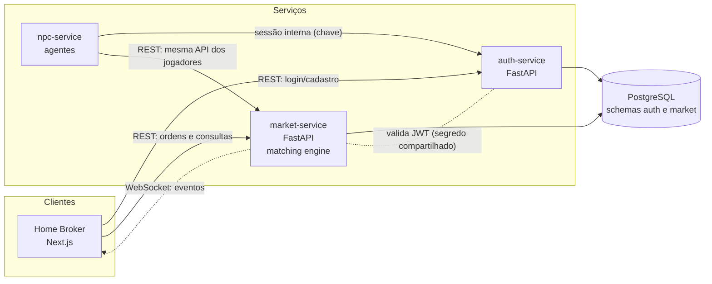
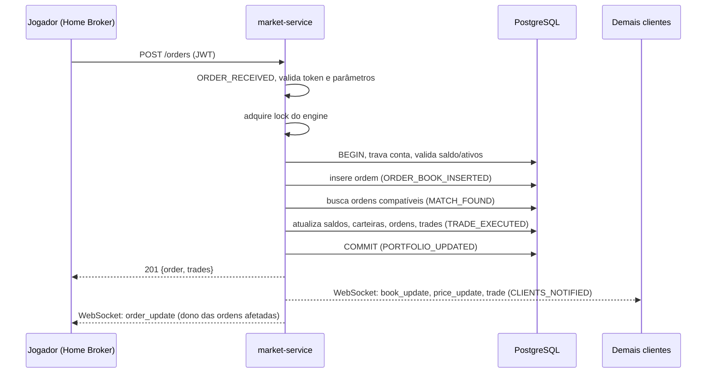

# Arquitetura

## Componentes

## Fluxo de uma ordem

## Decisões

| Tema | Decisão | Justificativa |
|---|---|---|
| Estilo | Microsserviços leves por responsabilidade | Auth isolado, mercado como único dono do estado, NPCs podem cair sem afetar o mercado |
| Protocolos | REST para comandos, WebSocket para eventos | Comandos precisam de resposta e status HTTP; eventos precisam de push em tempo real |
| Consistência do mercado | Forte: lock global no engine e uma transação por ordem | Ordem total das ordens (prioridade temporal) e atomicidade de saldo, carteira e negociação |
| Consistência da interface | Eventual | O cliente recebe eventos por WebSocket e ressincroniza por REST após reconectar |
| Persistência | PostgreSQL (ACID) | Transações garantem que ordem + negociações + saldos sejam gravados juntos ou nenhum |
| Segurança | JWT, bcrypt, validação com Pydantic, dono verificado em cada ordem | Ordens de outro usuário aparecem como inexistentes |
| Agentes | Clientes comuns da API, com prefixo `npc_` reservado | O mercado não confia no cliente: o prefixo só é obtido por chave interna |

## Limitações conhecidas e evolução

- O lock global limita o throughput a um escritor. Evolução: particionar por ativo (um engine por símbolo) com saldo reservado antes do casamento.
- O market-service tem uma única instância; a falha dele é detectada e recuperada pelo `restart` do Docker e pela reconexão dos clientes, sem perda de dados confirmados.
- O banco é único (schemas separados). Evolução: um banco por serviço e/ou réplica de leitura.
