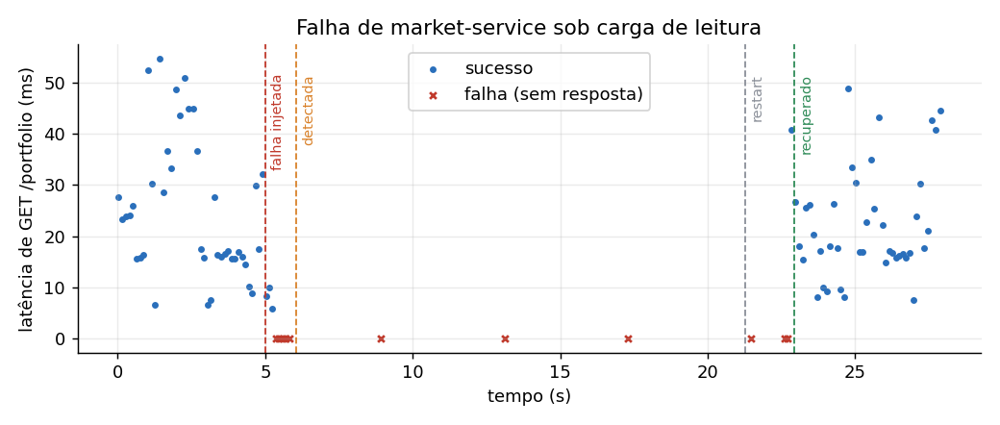
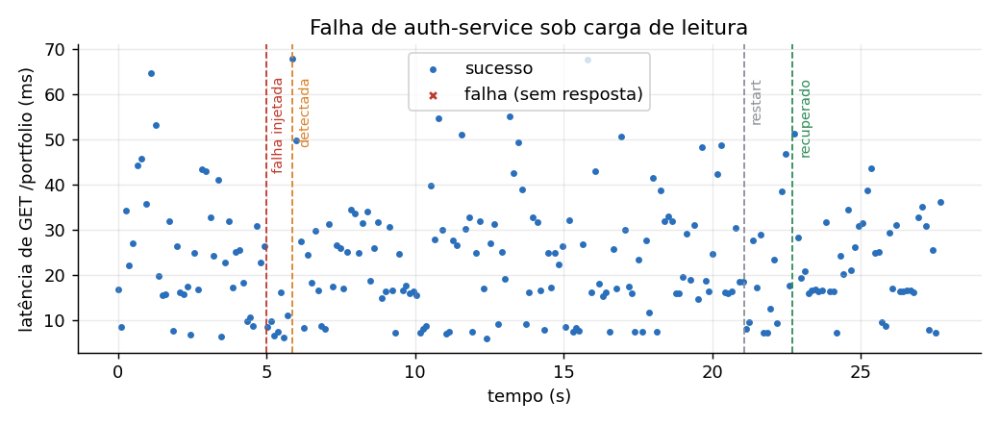
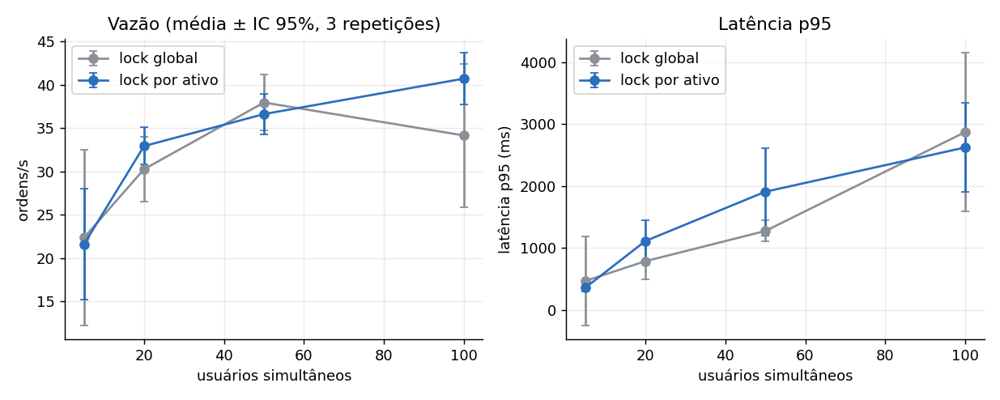

# Relatório de testes — Simulador de Bolsa (Parte 2)

## 1. Ambiente e versão testada

- Versão testada: tag Git `4c19da0`.
- Software: Docker version 28.3.2, build 578ccf6; Python 3.12; FastAPI; PostgreSQL (imagem do compose); Next.js.
- Topologia: 1 `market-service`, 1 `auth-service`, 1 `npc-service` (14 agentes), 1 PostgreSQL, 1 frontend, todos em contêineres.
- **Todos os serviços, o banco e o gerador de carga rodam na MESMA máquina física** (Docker Desktop, 5,8 GiB de RAM para o Docker). Os resultados de desempenho medem a máquina inteira e **não** isolam cada componente.
- *Preencher:* CPU, RAM total, tipo de disco da máquina. Rede: tráfego em `localhost`/rede virtual do Docker (latência desprezível).

## 2. Testes funcionais

| ID | Objetivo | Esperado | Obtido | Status |
|---|---|---|---|---|
| F01 | Cadastro e login geram JWT | token não vazio | token ok | passou |
| F02 | Rota protegida sem token | 401/403 | 403 | passou |
| F03 | Token inválido | 401/403 | 401 | passou |
| F04 | Listar ativos | 5 ativos | 5 | passou |
| F05 | Carteira inicial | saldo 100000 | 100000.0 | passou |
| F06 | Venda sem ativo | 422 | 422 | passou |
| F07 | Compra acima do saldo | 422 | 422 | passou |
| F08 | Parâmetros inválidos (quantidade negativa) | 422 | 422 | passou |
| F09 | Status de ordem e autorização (dono vs outro) | 404 para outro, cancelamento só do dono | criar=201 status=200 outro_lê=404 outro_cancela=404 dono_cancela=200 | passou |
| F10 | Ordem fora do mercado fica OPEN no livro | OPEN | OPEN | passou |
| F11 | Cruzamento executa ao preço do livro | FILLED/PARTIAL | status=FILLED executada=1 | passou |
| F12 | Concorrência: 20 compras simultâneas (R$20k cada) | só as que cabem no saldo | esperado=4 aceitas=4/20 disponível=19999.94 | passou |

Resumo: 12/12 passaram. Evidência: `tests/part2/results/functional.json` (reexecutável com `python tests/part2/functional.py`).

### Concorrência entre ativos (invariantes)

Após a carga com 175 usuários criados e ~2.600 negociações adicionais, consultas diretas ao banco mostraram: **0 contas com saldo negativo, 0 posições negativas, total de ativos em carteira constante (70.000)** e variação do dinheiro total igual exatamente a 175 × R$ 100.000 (saldo inicial dos usuários novos). Ou seja, dinheiro e ativos se conservam sob concorrência.

## 3. Tolerância a falhas

Procedimento: (1) cria uma ordem aberta e guarda a carteira de referência; (2) carga contínua de leitura (10 req/s); (3) `docker compose stop` do serviço; (4) mede detecção, espera e `start`; (5) compara carteira e ordem aberta.

### Falha de `market-service`

| Evento | t (s) |
|---|---|
| Falha injetada | 5.0 |
| Falha detectada (sem resposta) | 6.05 |
| `start` do serviço | 21.26 |
| Serviço de volta | 22.92 |

- Tempo de recuperação após o restart: **1.66 s**; disponibilidade de leitura na janela inteira: **88.5%** (96 requisições).
- Estado preservado (carteira e ordem aberta idênticas): **True**.

### Falha de `auth-service`

| Evento | t (s) |
|---|---|
| Falha injetada | 5.0 |
| Falha detectada (sem resposta) | 5.86 |
| `start` do serviço | 21.06 |
| Serviço de volta | 22.71 |

- Tempo de recuperação após o restart: **1.65 s**; disponibilidade de leitura na janela inteira: **100.0%** (224 requisições).
- Estado preservado (carteira e ordem aberta idênticas): **True**.

Análise: a queda do `market-service` torna o mercado indisponível (as requisições falham) até o contêiner voltar, mas **nada confirmado se perde** (PostgreSQL). A queda do `auth-service` **não afeta** quem já tem sessão, pois o JWT é validado localmente no `market-service` (disponibilidade 100% no experimento); só novos logins falhariam. A detecção aqui é por falha de requisição (não há monitor de saúde dedicado) e o Docker reinicia o serviço (`restart: unless-stopped`). **Não testado:** queda do `npc-service` e do PostgreSQL; falha no meio de uma transação foi apenas argumentada (rollback automático), não injetada.

## 4. Escalabilidade e desempenho

Carga: N usuários simultâneos enviando ordens limitadas aleatórias perto do preço (e consultando `/assets`), 10 s por repetição, 3 repetições + 1 aquecimento descartado. Resultado: média ± IC 95%.

| Usuários | Ordens/s (lock por ativo) | p50 (ms) | p95 (ms) | Ordens/s (lock global, antes) | p95 global (ms) |
|---|---|---|---|---|---|
| 5 | 21.6 ± 6.4 | 135.9 ± 56.8 | 357.2 ± 65.4 | 22.4 ± 10.1 | 466.7 ± 717.6 |
| 20 | 32.9 ± 2.2 | 397.0 ± 43.9 | 1110.6 ± 339.4 | 30.3 ± 3.8 | 784.8 ± 289.7 |
| 50 | 36.6 ± 2.4 | 878.9 ± 223.5 | 1906.7 ± 708.2 | 38.0 ± 3.2 | 1272.6 ± 171.2 |
| 100 | 40.7 ± 3.0 | 1299.8 ± 239.0 | 2622.0 ± 723.7 | 34.2 ± 8.3 | 2870.5 ± 1286.9 |

**Joelho da curva:** a vazão para de crescer em ~35–40 ordens/s a partir de 50 usuários, enquanto o p50 passa de ~170 ms (5 usuários) para ~1,8 s (100 usuários): a latência cresce com a fila sem ganho de vazão.

**Lock global → lock por ativo:** a mudança (um lock por ativo, travamento das contas em ordem crescente de `user_id` para evitar deadlock) **não trouxe ganho mensurável** nesta máquina: as diferenças estão dentro dos intervalos de confiança (que são largos). O gargalo passou a ser outro: o PostgreSQL chegou a ~35% de CPU, existe **um único processo Python** (GIL) e o gerador de carga e os 14 agentes compartilham a mesma máquina. O ganho teórico do lock por ativo só apareceria com mais CPU/instâncias. Houve picos de latência de 4–6 s em algumas repetições (p95 com IC largo); a causa não foi investigada.

## 5. Problemas encontrados, correções e limitações

| Problema | Causa | Correção |
|---|---|---|
| F12 falhou na primeira execução do teste | Expectativa errada do teste (esperava 5 compras aceitas; só cabiam 4 pois R$ 0,06 já estavam reservados) | Teste passou a calcular o esperado a partir do saldo disponível |
| Resultados de carga não salvos | Scripts usavam caminho relativo ao diretório atual | Caminhos relativos ao arquivo do script |

**Limitações que permanecem:** instância única do `market-service` (o lock por ativo é de processo; réplicas exigiriam travas no banco ou particionamento por ativo entre instâncias); PostgreSQL único; testes em uma só máquina; falhas de `npc-service`/PostgreSQL não testadas; sem teste de caos automatizado; picos de latência não explicados; sem monitor ativo de saúde dos serviços (apenas `/health` e `/metrics`).

## 6. Análise crítica

- **Gargalos:** CPU compartilhada na máquina de teste, processo Python único (GIL) e PostgreSQL; a serialização por ativo limita o *pior caso* (todos negociando o mesmo ativo ⇒ continua serial).
- **Pontos únicos de falha:** `market-service`, PostgreSQL e o `auth-service` (para novos logins). O estado confirmado sobrevive a reinícios.
- **Para 10× / 100×:** um engine por ativo em processos/instâncias separadas (sharding) com saldo reservado antes do casamento; réplica de leitura e pool de conexões (PgBouncer); fila de eventos (Kafka/NATS) para notificações; várias instâncias atrás de balanceador com *sticky* WebSocket; PostgreSQL com réplica/HA (Patroni) ou banco distribuído (CockroachDB).
- **Observabilidade:** `GET /metrics` (JSON) no `market-service`: uptime, requisições por rota/status, latência p50/p95/p99, ordens/s, negociações e usuários online; logs JSON por ordem (`ORDER_RECEIVED → ... → CLIENTS_NOTIFIED`).

## 7. Anexos

Scripts em `tests/part2/` (`functional.py`, `load.py`, `faults.py`, `plots.py`, `report.py`); dados brutos em `tests/part2/results/` (`load.csv`, `load_summary*.json`, `fault_*.json`, `functional.json`, `docker_stats.csv`).
